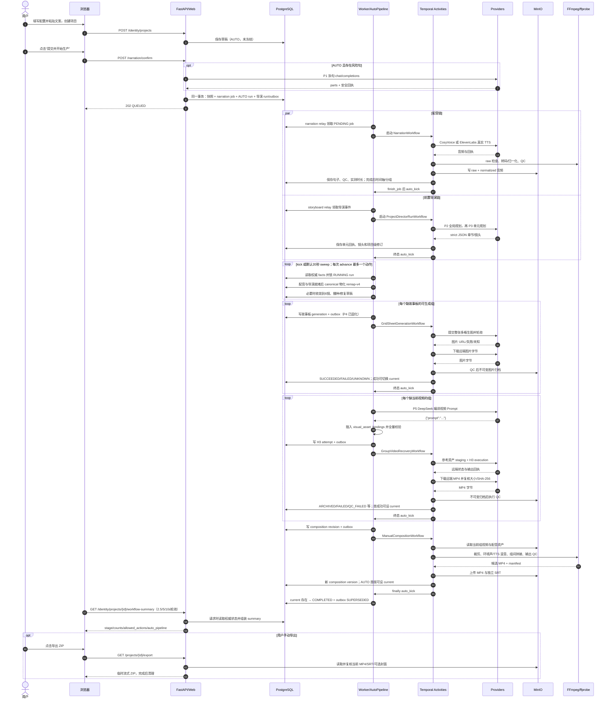

# 视频项目端到端链路总览与时序

> 本文用图和矩阵索引主链。精确函数与行号见 [流程说明](./PROJECT_VIDEO_E2E_FLOW_20261014.md)，Prompt 编号对应 [Prompt 清单](./PROJECT_VIDEO_E2E_PROMPTS_20261014.md)，状态细节见 [状态与异常](./PROJECT_VIDEO_E2E_STATE_ERRORS_20261014.md)。图中内容均为【已确认】代码路径；实际执行先后和部署覆盖配置不作推断。

## 1. Mermaid 全链路总览

```mermaid
flowchart TD
    A["POST /identity/projects"] --> B["草稿 Project<br/>production_mode=AUTO<br/>snapshot=None"]
    B --> C["POST /narration/confirm"]
    C --> D{"存在估算风险句？"}
    D -->|是| S["P1 DeepSeek 拆句<br/>每风险句最多3次"]
    D -->|否| F["冻结事务"]
    S -->|全部成功| F
    S -->|最终失败| X0["提交失败<br/>不创建本次快照/job/AUTO run"]
    F --> F1["不可变项目快照<br/>NarrationJob PENDING<br/>AutoPipelineRun RUNNING<br/>Director Run INTENT_PERSISTED"]

    F1 --> NO["narration outbox"]
    F1 --> DO["PROJECT_DIRECTOR_RUN_REQUESTED outbox"]

    NO --> N["真实配音 CosyVoice / ElevenLabs<br/>无 Prompt"]
    N --> NQ["raw + normalized QC<br/>MinIO 音频资产"]
    NQ --> T["实测时间轴与≤15s分组"]
    T -->|单句>15s| P0["PAUSED<br/>oversized_sentence"]

    DO --> D1["P2 全局规划 + P3 单元规划<br/>ProjectDirectorRunWorkflow"]
    D1 --> R["项目级前置导演修订"]

    T --> M["确定性物化 remap-v4<br/>无外部 AI"]
    R --> M
    M --> CV[">6镜时 adjacent-merge-v1<br/>确定性相邻合并"]
    CV --> SD["草稿播种 + AUTO 系统审批<br/>无 Prompt"]
    SD -->|结构冲突| P1["PAUSED<br/>director_validation_failed"]
    SD --> SB["P4 整张多格故事板<br/>本地拼装 + 安全替换"]
    SB --> SBA["图片下载/QC/MinIO 归档<br/>成功版本可成为 current"]
    SBA --> VP["P5 DeepSeek 视频提示词编译<br/>代码后拼 visual_asset_bindings"]
    VP --> H3["每组 H3 参考图视频<br/>staging → executions → recovery"]
    H3 --> VA["MP4 下载/哈希/QC/不可变归档<br/>首成功可成为 current"]
    VA --> CO["composition outbox → Temporal<br/>FFmpeg 裁剪/混音/拼接 + SRT"]
    CO --> CA["MP4+SRT 入 MinIO<br/>composition version"]
    CA --> CUR{"存在 current 成片？"}
    CUR -->|AUTO 首版无 current| SEL["自动 select_current"]
    SEL --> DONE["AutoPipelineRun COMPLETED<br/>合成 outbox 收口 SUPERSEDED"]
    CUR -->|是| DONE

    N -.失败/预算耗尽.-> PA["PAUSED + 稳定原因码"]
    D1 -.失败.-> PA
    SB -.终态失败.-> PA
    H3 -.终态失败.-> PA
    CO -.失败.-> PA
    PA -->|"POST /identity/projects/{project_id}/auto-pipeline/resume"| RR["授权轮次+1<br/>PAUSED→RUNNING"]
    RR --> ADV["advance() 重读权威 facts<br/>进入当前对应阶段，不重跑冻结事务"]

    DONE -->|用户手动 GET /projects/{project_id}/export| ZIP["临时 ZIP<br/>final.mp4 + subtitles.srt + 可选封面"]
    F1 -.独立手动，非 AUTO.-> COVER["P6–P11 封面链"]
```

## 2. 分时调用时序图



## 3. 每一步输入、输出、状态与失败处理矩阵

| 环节 | 主要输入 | 主要输出 | 权威状态/存储 | 失败、重试与异常出口 |
| --- | --- | --- | --- | --- |
| 创建草稿 | 频道、粘贴文案、角色图、风格、语言、画幅、音色 | AUTO 草稿项目 | `Project(snapshot=None)`；PostgreSQL | 校验失败直接拒绝；无自动重试；无 Prompt |
| 拆句 | 确定性分句后的风险句、locale | 2–8 个无损连续片段、回执与拆分血缘 | 冻结前同步计算；成功后随提交持久化 | 每风险句最多3次，5/15/30s；最终失败则本次不冻结、不入队 |
| 提交事务 | 草稿、拆句计划、配置 | 快照、narration job、AUTO run、导演 run/outbox | 同一 DB 事务；AUTO=`RUNNING/narration` | 行锁与已有 job 幂等；缺配置/血缘等明确报错 |
| 配音 | 冻结句、音色/克隆音色、幂等键 | 每句 raw+normalized WAV、QC、实测时长 | attempt 9态；job 5态；DB+MinIO | AUTO 对 SAFE/UNKNOWN/OUTPUT_INVALID 按句重试；明确拒绝与归档失败不走普通自动重试 |
| 时间轴/分组 | 全部合格句的帧数与采样率 | 权威句子、组与成员关系 | DB 同事务重建；普通组≤15s | AUTO 单句>15s → PAUSED `oversized_sentence` |
| 前置导演 | 冻结句、全局上下文、角色哈希、风格、locale、画幅 | 全局章节、项目级镜头与句子链接 | run/unit 状态；不可变修订与回执 | 每单元最多3次，5/15/30s；FAILED → `director_preplan_failed` |
| 物化/收敛 | 前置修订 + 实测分组 | 组级候选、final draft、来源血缘 | canonical 幂等；算法 `remap-v4` | 无外部 AI；>6镜确定性合并；冲突不自动放行 |
| 草稿播种 | 物化候选 | 每组草稿/系统审批 | DB 草稿修订 | 非法组 → `director_validation_failed`；保存有效草稿可按原因码恢复 |
| 故事板 | 已应用镜头、实测区间、风格、角色数 | 整图、QC、不可变版本 | generation 状态机；DB+MinIO | AUTO 对 connect/429/部分未知链有界重提；明确失败、处理异常分支不同 |
| 视频 Prompt | 镜头、实测切镜点、参考图标签、风格、时长 | 六段英文 H3 Prompt + binding 行 | 编译文本与指纹写入 attempt 输入快照 | AUTO 最多2次输出修复；临时故障另有内部退避计数；失败不降级旧 Prompt |
| H3 视频 | 编译 Prompt、角色图+故事板、时长、画幅、workflow 快照 | 原始 MP4、QC、归档资产 | attempt stage/archive_stage；DB+MinIO | AUTO 按分支处理重提/QC重生成/停滞；candidate 未知与404有更严证据门禁 |
| 合成 | 当前组视频、配音、字幕句、画幅/帧率 | MP4、SRT、manifest、候选版本 | outbox/job/version；DB+MinIO | 临时合成故障 AUTO 最多3次 job 尝试；每60秒对账失联 DISPATCHED workflow，并在预算内排程新代际 |
| 完成 | 前置门禁满足 + current 成片 | AUTO COMPLETED；outbox SUPERSEDED | `auto_pipeline_runs` | COMPLETED 为终态；不会自动导出或生成封面 |
| 状态通知 | 各权威表 | workflow-summary 响应 | GET 请求时投影 | 内部 kick 失败只记日志，sweeper 兜底 RUNNING；无对外推送实现 |
| 导出 | 当前 MP4/SRT/可选封面 | 临时 ZIP 流 | 本地临时目录，非持久资产 | 用户手动触发；结束/中断清理；AUTO 不自动执行 |

## 4. 并行与顺序的准确理解

- **并行**：提交后配音和前置导演拥有各自 outbox/workflow，可同时进行。
- **汇合**：物化必须同时有当前前置导演修订和精确覆盖视觉句的权威分组。
- **AUTO 决策顺序**：配音 → 超长句门禁 → 导演 → 物化 → 故事板 → 视频 → 合成；这是门禁顺序，不表示导演必须等配音完成才启动。
- **完成顺序**：`composition job SUCCEEDED` 与“存在 current 成片”不是同一事实；AUTO 完成以 current 为准。
- **运行值未确认**：真实 Provider 耗时、实际并发先后、部署选择的故事板 Provider/模型/H3 profile 不从静态代码推断。
